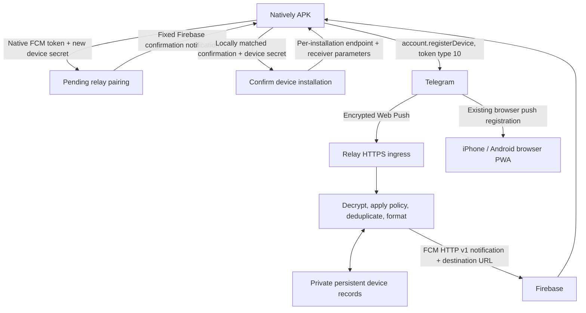

# Natively full-preview notification plan

Date: 2026-10-20  
Status: Research implementation record. The dedicated AWS relay infrastructure is removed at the owner's request on 2026-10-21; staging native relay enrollment is disabled. See the [setup and workflow guide](PWA_TO_APK_NOTIFICATIONS_GUIDE.md) and [cleanup record](NATIVELY_AWS_RESEARCH_CLEANUP.md). Background text delivery was verified during research; other payloads and app states require device verification.

## Implementation progress

- `server/native-push/relay.ts` provides bot-free device pairing, fixed-destination routing, private file persistence, registration leases, and privacy-policy expiry using Node.js built-ins
- The Natively client selects native enrollment when `NATIVE_PUSH_RELAY_URL` is configured; each installation confirms its own native Firebase delivery before registering the relay subscription with Telegram
- [Device relay setup and limits](../server/native-push/DEVICE_RELAY.md) describes the runtime configuration, management protocol, persistent storage, and separate relay container
- Native message cards use one account-and-chat tag and display only the latest received message preview. Android background verification confirms one card per distinct chat title and the user confirms that only the second of two new messages appears. Foreground system notifications need Natively's native handler/bridge before website integration; remaining chat types require verification. Packaged launcher and notification-icon corrections require a Natively rebuild, as described in the device relay guide
- Per-chat unread counts use app snapshots plus persisted message-ID/read/deletion metadata and appear as a numeric title suffix. Android device verification confirms matching title and native notification counts, with one latest-message preview per card. The user confirms a numeric launcher badge and a `(1)` count after reading the chat on another device and receiving one new message. Ambiguous counts stay hidden until refreshed; missing updates can leave counts stale until Telegram synchronization. Exact app-icon totals and immediate removal/count changes on existing cards need Natively's native badge/update bridge; launcher aggregation alone does not guarantee a full-account unread total
- The expiring operator probe, console helpers, and dedicated probe deployment template remain available for protocol diagnosis
- The supplied Firebase service account matches the Android configuration and successfully obtains Google authorization; this alone does not establish device delivery
- The isolated staging deployment template passes AWS validation and its read-only network/routing inspection; no probe stack is deployed
- Backend type checking, changed-client lint, the staging website build, and the published Web Push encryption example pass; the repository-wide lint check has existing unrelated failures
- The external admin backend contains a browser push forwarding relay; its shared-key enrollment and staff Cognito login do not establish ordinary Telegram account ownership
- No verification bot or additional login is required: the relay pairs an installation with its fixed native destination, while the existing Telegram session registers that installation's endpoint
- A local exercise with simulated Firebase responses verifies pairing, authorization, two-device isolation, encrypted message forwarding, deduplication, privacy changes during dispatch, and independent revocation; it sends no real notifications
- Research verification used website task definition `dtbgram-web-staging:3` and relay task definition `dtbgram-native-push-staging:8`; the active device survived a relay restart
- The APK waits for the page to be hidden before requesting its setup notification; a distinct non-secret query parameter makes Natively open the confirmation link
- Live Telegram `MESSAGE_TEXT` pushes arrive as legacy `aesgcm`, decrypt successfully, produce `previewReady`, and reach Firebase; the user confirms the Android message notification appears
- Published legacy draft-04 and modern RFC 8291 encryption examples both decrypt successfully; malformed legacy headers and tampered ciphertext are rejected

The relay routes by per-device capability. It does not provide account-wide authorization, verify a supplied Telegram ID, or fetch Telegram message history. Policy is a refreshed snapshot with a twenty-four-hour preview lifetime; the relay cannot observe an offline privacy-setting change instantly. Android background text-message delivery is verified. Other media, closed-app behavior, and native tray updates require device verification.

## Goal

Deliver native Android notifications in the Natively APK while the app is in the background or closed. Show the sender or group name, message text, available captions, and clear media descriptions. Keep delivery independent for each device, including a user with an Android APK and an iPhone PWA.

The first delivery target is the existing Android APK. iPhone PWA notifications continue through the existing service worker. A future Natively iOS app needs its own native configuration and verification.

## Current findings

The connected APK has native notification permission and an FCM token. Its service worker is active, but `PushManager` is unavailable. Configuring `NATIVE_PUSH_RELAY_URL` selects native SDK registration inside the wrapper; native notification delivery uses the relay's separately deployed HTTPS routes.

The repository contains a Natively console integration, browser notification handling, Telegram device registration helpers, and the separate native device relay. The web Docker image serves static files through Nginx; the relay runs in its own server process/container.

## Preview scope and feasibility limits

The device relay decrypts Telegram push content and converts it into a normal Firebase notification. It does not need to store users' Telegram login sessions for this route.

Telegram's Web Push registration accepts an HTTPS endpoint and recipient keys. Its notification payload describes the event and available preview fields. Some documented media payloads omit captions. Those missing fields require a separate source of message data. [Telegram push documentation](https://core.telegram.org/api/push-updates)

| Content | Planned result |
| --- | --- |
| Plain text | Sender/chat title and supplied message text |
| Photo or video with supplied caption | Media indicator and caption |
| Photo or video without supplied caption | A localized photo/video description |
| Image or video sent as a file | A localized file description and supplied filename/text |
| Group, channel, or bot message | Correct title and available author, text, and media description |
| Other supported media | Existing localized sticker, voice, audio, GIF, contact, location, poll, and other descriptions |
| Preview disabled or app passcode enabled | Existing privacy restrictions apply |
| Actual image/video thumbnails | Separate scope; requires media retrieval and a suitable native presentation path |

**Caption checkpoint:** capture real payloads during staging verification. If required captions are absent, report the gap before promising preview parity. Guaranteed captions or thumbnails would require an additional authenticated Telegram fetch design or custom native support. They cannot be reconstructed from a media type alone.

## Architecture

The relay owns a separate receiver key pair for each installation/account. Browser subscriptions and their private keys remain separate. The Natively FCM token is the fixed output destination for that record. Delivery confirmation proves access to the installation receiving the native notification; it does not prove Telegram identity. The authenticated Telegram client registers the receiver endpoint. This routing model needs no account lookup or account-wide send permission.

Natively documents native token/permission methods and notifications containing `title`, `body`, and `data.url`. Its published Firebase bridge does not document an arbitrary background-data handler or a tray-notification dismissal API. [Natively Firebase integration](https://docs.buildnatively.com/natively-platform/features/notifications/firebase-push-notifications-advanced)

## Phase 0 — Prove the delivery route

Complete these checks on staging before releasing the device relay:

1. Send a controlled Firebase notification to the current native token; confirm one visible card and a working tap destination. Record foreground, background, and closed-app behavior separately.
2. Provision one temporary HTTPS relay endpoint and receiver keys. Register it using the existing authenticated Telegram client and `registerDevice` helper with token type `10`; require a successful Telegram acknowledgement.
3. Capture the actual HTTP method, content encoding, relevant authorization headers, and encrypted body format. Decrypt a real push using the applicable Web Push encoding. Inspect sensitive content only in a controlled session; keep permanent diagnostics content-free.
4. Verify private, group, bot, channel, photo, video, caption, and file payloads. Record which edit/delete/read events actually arrive while the APK is closed.
5. Confirm sender authorization requirements. Payload decryption authenticates ciphertext integrity; it is not by itself proof of Telegram sender identity. Validate observed VAPID authorization where applicable and document the endpoint capability model.
6. Verify whether Natively preserves Android notification tags, handles deep links, and displays its own foreground cards. Establish one owner for notification display in each app state.
7. Verify device-confirmation binding: an unsolicited deep link, wrong local token/account, wrong management secret, expired challenge, or substituted receiver cannot activate another installation. Confirm the single-process storage and deployment limits before public rollout.

For modern Web Push, implement receiver decryption against [RFC 8291](https://www.rfc-editor.org/rfc/rfc8291) and [RFC 8188](https://www.rfc-editor.org/rfc/rfc8188), validating key sizes, record boundaries, authentication tags, and padding. Confirm the observed encoding before choosing an implementation. The existing MTProto `data.p` decryptor handles a different envelope.

**Exit criteria:** one real Telegram message becomes one native notification with the expected preview; caption coverage and native update limitations are documented. Remove the temporary registration and debugging artifacts after the check.

## Phase 1 — Add the relay backend

### Hosting and persistence

Proposed AWS setup in `ap-southeast-1`:

- A separate Node.js relay service on ECS, with its own image, task definition, IAM role, and health check.
- An HTTPS route on the existing load balancer, if compatible, or a dedicated relay hostname.
- Persistent encrypted storage for private device records; the implemented single-process file store requires a mode-`0700` directory and mode-`0600` records.
- Secrets Manager for server-only Firebase credentials.
- A future database/queue migration if multiple replicas, durable retries, or bounded read/delete state are required.

Keep this service separate from the static web container. Confirm the actual AWS network, load balancer, persistent-storage, and account configuration before creating resources. Run one relay process/replica against the state directory; its exclusive lock prevents independent writers. The existing staging probe template does not deploy this device relay. No device-relay infrastructure is deployed by these source changes.

Use existing dependencies and Node.js crypto/HTTPS primitives. Review AWS signing, persistence, and credential access in Phase 0. Do not add Firebase, AWS, or Web Push libraries silently; if a maintained additional dependency is necessary, explain that requirement before implementation proceeds.

### Device confirmation and registration contract

The client creates a random device ID and management secret and stores them locally. It requests a pending pairing for its native token, then the relay sends a fixed confirmation notification to that exact token. The client accepts its tap only when it matches a locally initiated pairing, current native token, current account, and stored management secret. Pairing expires after ten minutes. Receiver subscription parameters become available only after confirmation.

The client registers that exact subscription with its existing authenticated Telegram session and activates the record after Telegram acknowledges token type `10`. No verification bot or additional login is involved. A Telegram ID in setup is consistency metadata; it is not evidence of account ownership. The relay exposes no user-ID lookup, cross-device account management, message fetch, or arbitrary-send API. The website API key is not used as identity proof.

Implemented routes:

| Route | Responsibility |
| --- | --- |
| `POST /native-push/pairings` | Create a pending record with device ID, secret, and setup; send fixed native confirmation |
| `POST /native-push/devices/:id/confirm` | Confirm the delivered challenge using the device management secret |
| `GET /native-push/devices/:id` | Read this record's status/expiry and confirmed receiver subscription |
| `POST /native-push/devices/:id/activate` | Confirm client registration acknowledgement; keep activation idempotent |
| `PATCH /native-push/devices/:id` | Refresh policy for the fixed native token/account; changing either requires new pairing |
| `DELETE /native-push/devices/:id` | Revoke this installation/account and invalidate queued sends |
| `POST /telegram-push/:capability` | Accept the observed encrypted Telegram delivery protocol |
| `GET /health` | Service health without user data |

Management routes require the exact configured app origin and device-specific bearer secret. Initial pairing supplies the new secret over HTTPS. The ingress route uses an unguessable per-registration capability plus Web Push protocol checks. Restrict request size, execution time, and request rate; redact endpoint capabilities from access logs. CORS is not authentication. Authenticated ciphertext does not independently identify Telegram as the sender; endpoint and receiver secrets must remain private.

Store an installation identifier, account metadata, native token, generation, exact Telegram registration token, receiver keys, status, timestamps, and policy version in protected persistent storage. Generate a fresh P-256 receiver key pair and a 16-byte auth secret for each installation/account. Return receiver parameters only after confirmation; retain the private key on the relay. Protect the state volume and backups with encryption at rest.

Use `pending`, `confirmed`, and `active` states, then revoke records explicitly. Registrations lease for thirty days; privacy snapshots permit previews for twenty-four hours. Expired policy hides content, and an expired lease stops delivery. Every send checks the current record, generation, expiry, and policy again. Registration acknowledgements are operational state, not identity proof.

### Sending and retry behavior

- Send directly to each native token with Firebase HTTP v1; use server-side OAuth credentials from the matching Firebase project. Keep those credentials out of `.env` values compiled into the website, Docker build arguments, and client bundles. [FCM server authorization](https://firebase.google.com/docs/cloud-messaging/auth-server)
- Include native `notification.title`, `notification.body`, and a validated same-app `data.url`. Reuse the app's chat routing format and verify access again when the destination opens.
- Keep delivery bounded and check revocation/expiry before sending. The current single-process receiver is not a durable queue and makes no exactly-once claim; uncertain Firebase results and process restarts require explicit operational handling.
- The device relay persists bounded dedup identities before dispatch. Before adding automatic retries, add read/delete state and recheck registration generation so obsolete content cannot replay after logout or token replacement.
- Keep message content transient. A future durable queue stores encrypted ingress; any preview cache needed for card reconstruction requires encryption, bounds, and explicit retention rules.

## Phase 2 — Connect the web client to native registration

1. Extend the existing Natively utility with typed, timed token and permission calls using the SDK already loaded by the app.
2. Select native push inside the wrapper before browser capability checks. Browser PWAs retain their existing transport.
3. Pair after Telegram login and native permission grant. Show the disclosure and require the locally matched Firebase confirmation tap. Persist the exact confirmed relay subscription, register it with Telegram, and activate only after successful acknowledgement. Retry interrupted steps idempotently.
4. On launch/resume, reconcile the current native token, permission, account, and relay generation. Replace only the current installation's token.
5. On notification disable or logout, disable relay delivery first, then unregister the exact Telegram subscription. Retain a pending cleanup record if Telegram is unavailable. Clear account-bound keys/state without touching another device.
6. Synchronize preview, mute, hidden-chat, and passcode policy on relevant changes. Distinguish notification enablement from the existing setting named `hasWebNotifications`.
7. Use one notification display path within the wrapper. Coordinate native foreground behavior with existing foreground notification code to avoid duplicate cards/sounds.
8. Show native registration status in notification settings instead of relying on `PushManager`. Reuse existing diagnostics and localized strings.

The service worker remains available for existing app behavior and browser PWAs. The APK's native push registration does not depend on browser `PushManager`.

### Expected code locations

| Area | Existing code to reuse or extend |
| --- | --- |
| Natively bridge | `src/util/natively.ts` |
| Transport lifecycle and preview context | `src/util/notifications.tsx`, `src/util/setupServiceWorker.ts` |
| Telegram registration | `src/api/gramjs/methods/settings.ts` |
| Message/control formatting | `src/serviceWorker/pushNotification.ts`, `src/util/pushNotificationContext.ts` |
| Settings and diagnostics | `src/components/left/settings/SettingsNotifications.tsx`, `src/util/pushDiagnostics.ts` |
| Localization | `src/assets/localization/fallback.strings` and generated language types |
| New backend and deployment | Proposed `server/native-push/` and dedicated files under `docker/ecs/` |

Extract only pure formatting/identity helpers needed by both runtimes. Do not import service-worker globals or IndexedDB code into the server. Preserve the existing Safari notification safeguards.

## Phase 3 — Format previews and apply privacy

- Reuse current event classification and localization keys. Parse private, group, and channel argument positions explicitly; a group name is never treated as a caption.
- Prefer supplied text/caption; otherwise use the specific media description. Respect hidden-content types instead of inferring unavailable content.
- Cover the media types already handled by the app, including albums, forwarded messages, stickers, voice notes, music, contacts, locations, polls, quizzes, games, stories, and checklists. Audit remaining service/reaction/call types explicitly; incoming call signaling needs separate native support if required.
- Derive titles from available sender/chat fields with the same preview restrictions as the client. Keep system attribution such as “from [app name]” separate from the notification title/body.
- Apply mute, per-chat preview, hidden-chat, screen-lock, and passcode policy before constructing the FCM payload. Missing or expired policy hides content; do not assume an uncached chat allows previews.
- Keep passcode-enabled preview restrictions even when the app was last unlocked. The relay cannot observe a live device lock or offline setting change; define policy expiry and enforce the available OS lock-screen visibility settings conservatively.
- Explain in the notification setup flow that full previews are decrypted by this relay and sent through Firebase. Do not log message bodies, captions, native tokens, or receiver keys.

Client UI text uses `lang()`. The relay uses the same localization resources or a bounded, validated localization snapshot from the client; it does not invent a second hardcoded English catalog.

## Phase 4 — Extend deduplication and message changes

This phase describes follow-up work. The device relay currently formats recognized message events and suppresses control events; it does not implement reliable native deletion/read cleanup or a durable retry queue. Validate the native capabilities before implementing the behaviors below.

Persist event identity using account, installation, event kind, message namespace, message identity, and revision. Private/basic-group message IDs use the account's common namespace; channel/supergroup IDs include the channel. Include peer context whenever supplied and never apply a channel deletion to another namespace.

Deduplicate replayed ingress and repeated message revisions. Keep bounded read/deletion markers so late deliveries cannot restore a known deleted/read message. Treat an ambiguous Firebase timeout as an uncertain send: a retry can still duplicate a card unless stable native replacement is verified.

| Event | Relay/native behavior |
| --- | --- |
| New message | One formatted card per message; first version avoids multi-message card aggregation |
| Duplicate or unchanged revision | Suppress |
| Edit received | Replace the matching card where native replacement is verified |
| Delete received | Mark deleted and suppress pending delivery; for an existing Android card, validate same-tag replacement with “Message deleted” |
| Read on another device | Suppress matching queued deliveries; remove existing cards only if a supported native cancellation path is available |
| Muted, badge-only, configuration, or live-location wakeup | Update supported internal state without an ordinary message alert |
| Unknown event | Record a content-free diagnostic; do not turn a control event into “New message” |

Android's `notification.tag` supports replacing an existing card. Verify Natively preserves it in every supported app state. `collapse_key` coalesces pending transport messages; it does not remove delivered cards. [FCM Android notification fields](https://firebase.google.com/docs/reference/fcm/rest/v1/projects.messages#AndroidNotification), [FCM collapsing behavior](https://firebase.google.com/docs/cloud-messaging/customize-messages/collapsible-message-types)

**Native parity checkpoint:** reliable silent card removal, cross-device read cleanup, exact timestamp behavior, and foreground replacement require capabilities beyond the currently documented bridge. If Natively does not expose them, record the limitation and the required vendor/native extension before claiming parity with the PWA. Only events actually delivered upstream can drive updates. Deletion does not create an unrelated “New message” alert.

Safari's visible-per-push fallback remains in the PWA. It is not applied to native relay control events.

## Phase 5 — Verify and roll out

Follow repository instructions: do not write test files. Run `npm run check:ts` for TypeScript changes, `npm run check:css` for SCSS changes, the relevant production build, and separate backend build/type checks. Report existing unrelated failures separately.

Manually verify on staging:

1. Android foreground, background, locked screen, and normal app closure; record force-stop and battery restrictions separately.
2. Private, group, bot, and channel text; photo/video with and without caption; media sent as files; representative remaining media and albums.
3. Two messages produce two appropriate cards without extra blank/generic duplicates. Duplicate ingress produces no additional card under verified native behavior.
4. Delete/edit the latest and an older message; delete media after earlier text such as `123`; confirm no stale media is reintroduced. Record unsupported native removal behavior explicitly.
5. Read on another device, muted chats, preview disabled, hidden chats, and passcode enabled.
6. One account on Android APK plus iPhone PWA: both receive independently; disabling/logging out one leaves the other working.
7. Multiple accounts on one installation, account switching, permission denial, token rotation, reinstall, expired registration/policy, and logout during a send.
8. Relay restart/outage, Firebase transient failure, invalid native token, duplicate/out-of-order ingress, bad ciphertext, and unauthorized registration/update requests. Confirm that an unsolicited pairing deep link and mismatched account/token cannot complete pairing.
9. Notification tap opens the right account/chat, including after cold startup; preview content is absent from logs and destinations.

Record safe per-hop evidence: registration acknowledgement, ingress ID, event classification, policy decision, dedup result, and Firebase outcome. Firebase acceptance is not proof that a card appeared; verify on the device. [FCM notification handling](https://firebase.google.com/docs/cloud-messaging/customize-messages/set-message-type)

Deploy the relay to an isolated staging environment first, then configure `NATIVE_PUSH_RELAY_URL` in the staging website build and enable native registration for controlled devices. Keep staging and production records/credentials separate. Continue using the existing web staging deploy script for the website; provision the relay and its persistent state separately. Rebuild the Natively APK only when native feature/configuration changes require it.

Rollback stops relay sending, revokes affected device registrations, and removes the client relay URL in the next build if necessary. An already-issued Firebase request cannot be recalled. Browser PWA subscriptions remain intact. Retain exact-subscription cleanup state and remove temporary debug instrumentation after verification.

## Inputs and evidence required before rollout

- Firebase project used by the APK and server-side permission to send to its native tokens.
- Staging HTTPS management/ingress routing, persistent state storage, AWS service configuration, and ownership of new resource provisioning.
- Reviewed per-device confirmation/capability handling, expiry, logout cleanup, and abuse controls; no separate Telegram identity exchange is required for this routing-only service.
- Phase 0 evidence for Telegram endpoint delivery, encryption, caption availability, and Natively notification behavior.

## Completion criteria

- A background/closed Android APK receives readable previews through the relay without requiring an open web page.
- Available text/captions and media descriptions render correctly for private, group, bot, and channel messages under the documented preview scope.
- Registration, logout, token rotation, and privacy settings work independently across devices and accounts.
- Repeated events do not create avoidable duplicates; control events do not produce misleading message notifications.
- PWA delivery remains functional, and any missing-caption or native card-update limitation is explicit before release.
- Operations have revocation, content-free diagnostics, a verified rollback path, and explicit delivery/retry limits; durable retries remain a separate requirement before claiming reliable queued delivery.
