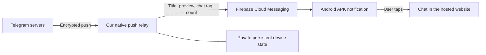
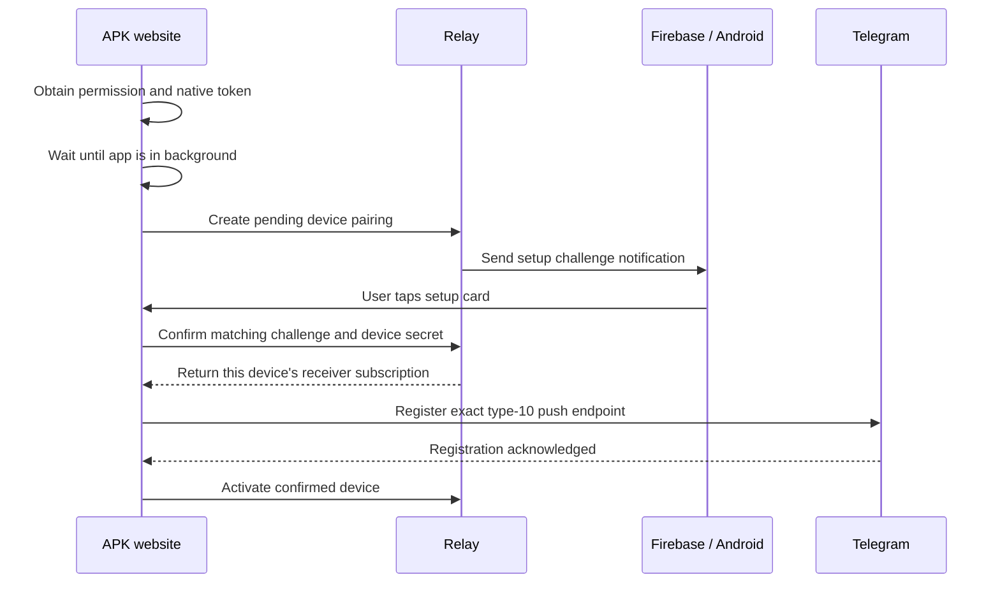

  # PWA to Android APK: Natively and Firebase notification guide

This guide explains how this Telegram web app becomes an Android APK, how its native notifications work, and how to reproduce the research setup. It covers configuration, deployment, notification enrollment, day-to-day behavior, debugging, and shutdown.

**Research status, 21 October 2026:** The dedicated AWS notification backend is removed at the owner's request. Native relay enrollment is disabled in the deployed staging website. The source implementation remains available for research. To resume native notifications, provision a new backend and pair devices again. See the [AWS cleanup record](NATIVELY_AWS_RESEARCH_CLEANUP.md) for verification and asynchronous deletion details.

## 1. Understand the three parts

The APK is a native Android shell created by Natively. It opens the hosted website inside a WebView. Updating that website updates the web interface inside the APK. Changing native features, Android configuration, or packaged icons requires a new APK build.

Notifications have a separate delivery path:

| Installation | Notification transport | Component that displays a background notification |
| --- | --- | --- |
| Browser or installed PWA | Browser Web Push | The website's service worker and browser |
| Natively Android APK | Telegram push → our relay → Firebase Cloud Messaging (FCM) | The native Firebase integration inside the APK |

On the research APK, the service worker was active but `PushManager` was unavailable. A working PWA subscription therefore does not establish working APK push. The APK needs its own native token and relay registration. An iPhone PWA and an Android APK signed into the same account keep separate registrations.



The website also receives live Telegram updates while open. Those live updates and background push are different paths; they must not both create duplicate cards.

## 2. Configuration files and keys

These settings serve different purposes. Adding one does not replace the others.

| Item | Where it belongs | Purpose |
| --- | --- | --- |
| `google-services.json` | Natively's Android Firebase configuration | Connects the packaged Android app to its Firebase project |
| Firebase web configuration, such as project ID and sender ID | Existing website configuration | Configures the browser/PWA integration |
| Public Web Push certificate/VAPID key | Browser/PWA configuration | Used by the browser Web Push subscription |
| Firebase Admin service-account JSON, including its private key | Server runtime secret manager only | Authorizes the relay to send through FCM |
| Native FCM token | Per-installation client state and the relay's private state | Identifies one APK installation as a delivery destination |
| Receiver private key, authentication secret, and endpoint capability | Private relay state; subscription parameters returned to its paired client | Decrypts Telegram's encrypted push for that registration |
| Device management secret | Private client state; protected server-side verifier | Authorizes management of one device registration |

Do not put the Admin private key in `.env` variables that enter the web bundle, browser code, Git, a public folder, Docker build arguments, or screenshots. The Android configuration file cannot authorize server sends. This web-only repository does not contain an Android Gradle project, so it does not need Android SDK installation instructions or a committed `google-services.json` to support the Natively build. [Firebase server authorization](https://firebase.google.com/docs/cloud-messaging/auth-server)

The research used Firebase project `justchat-aaf9c`, Android package `com.MUYoUwJjjMaM.natively`, and staging website `https://monoverse.biz/`. If you create another Natively app, use its actual package name when registering the Android app in Firebase.

## 3. Create the APK in Natively

1. Make sure the hosted website opens successfully over HTTPS and Telegram login works.
2. Create or open the app in Natively and set its website URL to the intended environment.
3. In Firebase Console, open the intended project and add an Android app using the exact Android package name supplied by Natively.
4. Download that Android app's `google-services.json` and upload it to the appropriate Natively Firebase configuration field.
5. In Natively, open **Features → Notifications → Firebase**, enable Firebase notifications, configure its permission prompt, and save.
6. Set the app name and launcher artwork in Natively's appearance settings.
7. Build a new APK, install it, and allow Android notification permission. Check the app's Android notification channel settings too.
8. Keep the Firebase project used by the APK and the server sender credentials consistent.

Natively packages the native Firebase integration. Its platform instructions cover the dashboard-specific configuration; manually adding Android Gradle dependencies to this website is unnecessary. [Natively Firebase setup](https://docs.buildnatively.com/natively-platform/features/notifications/firebase-push-notifications-advanced)

### Do I enable Natively's Service Worker feature?

That feature concerns web caching. It is not the native FCM transport and does not solve missing native notification registration. This website already manages its service worker for PWA functionality. Review caching compatibility before adding another worker configuration; use the native Firebase feature for APK notification delivery.

### When do I rebuild or reinstall?

| Change | Required action |
| --- | --- |
| Website interface or JavaScript | Build/deploy the website, then reload the APK page |
| Relay formatting or server handling | Build/deploy the relay; normally no APK rebuild |
| Natively Firebase feature, package settings, native bridge, or packaged icons | Rebuild the APK and install the new build |
| Firebase token rotates or APK state is lost after reinstall | Reconcile the installation and complete pairing again when required |
| PWA website update | Allow the app's normal service-worker update/reload flow; routinely deleting the PWA is unnecessary |

## 4. What our website integration does

The integration uses Natively's JavaScript SDK, pinned in `src/util/natively.ts` to version `2.26.0`. It detects the native wrapper, loads the bridge, checks notification permission, obtains the native Firebase token, and opens the in-app console. No additional npm library is required for these operations.

Native enrollment is selected only when both conditions hold:

- The app detects the Natively wrapper.
- The website was built with a non-empty `NATIVE_PUSH_RELAY_URL`.

For this research, that URL was `https://monoverse.biz`. It is a public origin, not a secret. Leaving it empty disables the relay enrollment path in the website build. It does not shut down an existing AWS task, remove stored data, or recall notifications already sent.

The Firebase Admin credential and `ENABLE_NATIVE_PUSH_RELAY=1` belong to the separate server runtime. They are not client build settings.

## 5. Deploy the relay on AWS

This section describes the dedicated research deployment. Resource IDs in the cleanup record are historical; create fresh resources when reproducing it. Use a staging environment first.

### 5.1 Prepare tools and credentials

You need AWS CLI access to the intended account, a running Docker daemon, Node.js 24, the correct Firebase Admin service-account JSON, and an existing or newly reviewed HTTPS hosting arrangement.

On a Mac, open Docker Desktop before building. `docker info` must include a working **Server** section. A successful ECR login alone does not prove the Docker daemon is running.

To prepare server authorization:

1. In Firebase Console, open **Project settings → Service accounts → Firebase Admin SDK** and generate a private key for the same project as the APK.
2. Save the downloaded JSON in a private local location outside this repository. Confirm that its `project_id` matches the Android configuration, without sharing its `private_key`.
3. In AWS Secrets Manager, choose **Store a new secret → Other type of secret**. In the plaintext editor, store the complete service-account JSON as the secret value. Do not wrap it inside an additional named string field.
4. Give it a dedicated environment-specific name, such as `dtbgram/native-push/staging/firebase`, and create it in the ECS task's region.
5. Copy the full secret ARN for the task definition and execution-role policy. A suffix such as `firebase-BoZMFV` is not the complete ARN.

The Google project must permit FCM HTTP v1 sends and the service account must have the required messaging permission. An authorization error here is separate from Android notification permission.

### 5.2 Build and push the server image

The relay has its own Dockerfile and image. It is separate from the website image.

```bash
REGION=ap-southeast-1
ACCOUNT_ID=YOUR_AWS_ACCOUNT_ID
REPOSITORY=dtbgram-native-push-staging
IMAGE_TAG=staging-REPLACE_WITH_UNIQUE_VERSION
REGISTRY="$ACCOUNT_ID.dkr.ecr.$REGION.amazonaws.com"
IMAGE_URI="$REGISTRY/$REPOSITORY:$IMAGE_TAG"

aws ecr get-login-password --region "$REGION" |
  docker login --username AWS --password-stdin "$REGISTRY"

docker build --platform linux/amd64 \
  -f server/native-push/relay.Dockerfile \
  -t "$IMAGE_URI" .

docker push "$IMAGE_URI"
```

Create the repository first if it does not exist. Match `linux/amd64` to an ECS `X86_64` task; an Apple Silicon laptop's default architecture may differ. Use the tagged image URI or an immutable digest in the task definition. ECR may display an image index, its image, and an attestation as separate rows; the version tag identifies the intended build.

The server image contains code and localization resources. Inject credentials at runtime; do not copy the Admin JSON into the image.

### 5.3 Configure networking

The research reused the website's VPC, subnets, shared HTTPS application load balancer, certificate, and ECS cluster. It added a dedicated relay security group and an EFS security group.

| Security group | Direction | Allowed traffic |
| --- | --- | --- |
| Relay | Inbound | TCP `8787` from the shared load balancer's security group |
| Relay | Outbound | HTTPS `443` to required external services, including Google |
| Relay | Outbound | NFS `2049` to the EFS security group |
| EFS | Inbound | NFS `2049` from the relay security group |

The task needs working outbound internet access. The research used existing public subnets with an assigned public IP and restricted inbound traffic. A private-subnet deployment needs a separately reviewed outbound path. Creating a new NAT gateway can add significant ongoing cost, so do not assume it is required by this design.

### 5.4 Create private persistent storage

Create an encrypted EFS file system in the same VPC, reachable through mount targets in the task's availability zones. Create an access point with:

- Root directory `/native-push-staging`.
- POSIX UID/GID `1000`/`1000`, matching the container's `node` user.
- Directory ownership `1000`/`1000` and permissions `0700`.

Mount it at `/app/state` in the container. Enable encryption in transit and IAM authorization in the ECS volume configuration. Individual private records use mode `0600`.

EFS created through the console can have automatic backups enabled. Decide on a backup policy deliberately and include recovery points in cost and privacy reviews. Removing the ECS task does not remove EFS or its backups. [EFS automatic backups](https://docs.aws.amazon.com/efs/latest/ug/automatic-backups.html)

### 5.5 Create the two IAM roles

Both roles trust the ECS tasks service, but their permissions differ.

| Role | Permissions |
| --- | --- |
| Execution role | Pull the ECR image, write CloudWatch logs, and read only the relay's Firebase secret; add KMS decrypt permission if the secret's customer-managed key requires it |
| Task role | `elasticfilesystem:ClientMount` and `elasticfilesystem:ClientWrite` on this EFS file system, conditioned on this access point |

In IAM, create each role for the **Elastic Container Service Task** use case, with `ecs-tasks.amazonaws.com` as its trusted service. The execution role can combine `AmazonECSTaskExecutionRolePolicy` with this inline policy; replace the placeholder with the full secret ARN:

```json
{
  "Version": "2012-10-17",
  "Statement": [{
    "Effect": "Allow",
    "Action": "secretsmanager:GetSecretValue",
    "Resource": "FIREBASE_SECRET_ARN"
  }]
}
```

The task role can use one inline EFS policy, replacing both ARN placeholders:

```json
{
  "Version": "2012-10-17",
  "Statement": [{
    "Effect": "Allow",
    "Action": ["elasticfilesystem:ClientMount", "elasticfilesystem:ClientWrite"],
    "Resource": "EFS_FILE_SYSTEM_ARN",
    "Condition": {
      "StringEquals": {
        "elasticfilesystem:AccessPointArn": "EFS_ACCESS_POINT_ARN"
      }
    }
  }]
}
```

The important distinction is the permissions and scope, not the number of policies. Do not attach the Firebase credential to a browser-accessible account role.

### 5.6 Register the ECS task definition

Use the actual relay image and the roles above. The research used Fargate, `awsvpc` networking, Linux `X86_64`, `256` CPU units, and `512` MiB memory.

| Setting | Value |
| --- | --- |
| Container name | `native-push-relay` |
| Container port | `8787` |
| `ENABLE_NATIVE_PUSH_RELAY` | `1` |
| `NATIVE_PUSH_APP_URL` | `https://monoverse.biz/` |
| `NATIVE_PUSH_RELAY_URL` | `https://monoverse.biz` |
| `NATIVE_PUSH_HOST` | `0.0.0.0` |
| `NATIVE_PUSH_PORT` | `8787` |
| `NATIVE_PUSH_STATE_DIR` | `/app/state` |
| Runtime secret `FIREBASE_SERVICE_ACCOUNT_JSON` | Full ARN of the dedicated Secrets Manager secret |
| Persistent mount | EFS access point → `/app/state` |
| Logging | Dedicated CloudWatch log group with an explicit retention policy |

Keep `/health` available to the internal health checker. Do not publicly expose private state or secret files. Use [DEVICE_RELAY.md](../server/native-push/DEVICE_RELAY.md) for the complete runtime and API contract.

### 5.7 Create the target group and routing

Create an **IP** target group using HTTP port `8787`; set its health path to `/health`. Attach it to the ECS service's relay container and port.

On the existing HTTPS listener, add a rule matching the staging host and these paths:

```text
/native-push/*
/telegram-push/*
```

Forward them to the relay target group before the website's catch-all rule. Preserve the complete request path. The first path is device management; the second receives encrypted Telegram push. `/health` can remain an internal target health check.

Keep authorization headers, capability paths, pairing fragments, native tokens, and message content out of access logs and support screenshots.

### 5.8 Create a single-replica ECS service

Run **one** task for this file-backed implementation. Its state directory has an exclusive process lock; it is not a multi-writer database.

The research service used rolling deployment with minimum running tasks `0%`, maximum `100%`, and **Availability Zone rebalancing disabled**. These settings allow the old process to stop before another process acquires the same state directory. They cause a brief outage during deployment. Load-balancer draining can extend the wait.

If the console rejects a maximum of `100%` while Availability Zone rebalancing is on, disable that feature for this single-writer service. Increasing the maximum to `200%` without changing the persistence design can start competing writers.

### 5.9 Deploy the website configuration

Build the website with `NATIVE_PUSH_RELAY_URL` set to the public HTTPS relay origin. Deploy the website only after relay routing and target health are working.

Run the existing website helper from the repository root with `bash docker/ecs/deploy-staging.sh`, after checking its environment values and task-definition image reference. It deploys the website. It does not provision or deploy the persistent relay. The files named `deploy-native-push-probe` and `native-push-probe-staging.template.json` describe an operator probe, not the full persistent device service.

An ECS force-new-deployment reuses the image reference in its task definition. If that reference contains a unique version tag, pushing a different `staging` tag does not select the new image. Register a task-definition revision pointing to the intended image, then update the service to that revision.

## 6. Enable notifications inside the APK

1. Open the APK and sign in to Telegram.
2. Open **Settings → Notifications** and enable **Offline Notifications**. Read the disclosure about server-side preview processing.
3. Allow native Android notification permission if prompted.
4. When the app asks you to press Home, put the APK in the background. Do not leave its console open in the foreground for this step.
5. Open the Android notification panel and tap the new **Enable notifications** setup card.
6. The same APK should open and complete confirmation. Return to the settings page to inspect status.
7. Keep the APK in the background. From another Telegram account, send a new message and leave it unread on the receiving account's other devices. Check the notification panel.

If pairing was interrupted, use **Reconnect notifications** once and follow the background prompt. Repeatedly requesting setup cards can reach rate limits and makes old cards confusing. Use the newest card; setup challenges expire after ten minutes.

### Why there is a setup notification

The relay must confirm that this browser session can receive a native notification at the token it supplied. It sends a challenge to that fixed token. Tapping the card returns the challenge to the same locally initiated setup.

After confirmation, the app obtains its receiver subscription and registers that exact endpoint with Telegram using the existing signed-in Telegram session and token type `10`. It then activates the relay record.



No verification bot or extra Telegram login is required. This design binds a private receiver endpoint to one confirmed native destination. The supplied Telegram user ID is consistency metadata; it is not server-verified identity or permission to fetch that account's messages. The relay never receives the user's Telegram session keys.

## 7. What happens when a message arrives

1. Telegram sends encrypted Web Push to the private endpoint registered by the app.
2. The relay checks that the device is active and its lease is valid.
3. It decrypts the payload using that device's receiver keys. The implementation supports legacy `aesgcm` and modern `aes128gcm` payloads.
4. It classifies the event and applies preview policy, mute/exclusion settings, and duplicate suppression.
5. For an eligible message, it builds a localized title and latest-message preview, a stable chat tag, a tap URL, and an unread count when reliable.
6. It authenticates to Google using the server-only Admin credential and sends through FCM HTTP v1.
7. Android's native Firebase integration displays the background notification. Tapping it opens the chat URL in the APK.

The relay decrypts content transiently to create full previews. Private state stores receiver credentials, the fixed native destination, policy snapshots, leases, deduplication data, and numeric message/read metadata. It does not store message preview history or log message bodies. Firebase receives the title and body needed for display.

A successful FCM response means Firebase accepted the request. Device permission, notification channels, network access, Android state, and the native handler still determine whether the user sees a card. [Firebase Android message handling](https://firebase.google.com/docs/cloud-messaging/android/receive-messages)

### Cards and previews

| Event or setting | Current native behavior |
| --- | --- |
| Private chat | One stable card per account and sender/chat |
| Group or channel | One stable card per conversation; group preview can include the author |
| Another message in that conversation | Replaces its card with the latest received message preview |
| Supported media | Localized media label/icon and available caption; the relay cannot retrieve missing captions or thumbnails |
| Read, delete, mute, or unknown control event | Does not create an ordinary message-alert card |
| Preview disabled, locked, or policy expired | Hides preview content according to policy |
| Muted or excluded chat | Suppresses the ordinary alert |

Delivery order determines which replacement Android shows. This relay is not a message-history fetcher or a durable exactly-once delivery queue. Existing cards created with older per-message tags must be dismissed once when checking conversation grouping.

### Unread count per chat and app-icon badge

The APK synchronizes unread counts and read/message watermarks for up to 64 recent loaded chats. The relay updates supported later message/read/delete metadata and persists counters. A reliable count appears in the title, for example **Kev (3)**, while the body shows only the latest message.

Duplicate and edit events do not increment that count. Ambiguous partial reads/deletions, a missing baseline, incomplete album identities, or too many retained message IDs hide the count until a fresh synchronization establishes it. Missing or delayed pushes can leave counts stale until the app synchronizes again.

The relay also supplies the per-chat count through FCM's Android notification count. The research phone displayed a numeric launcher badge. Other launchers can show a dot or handle counts differently. This is **not a guaranteed exact total across all unread chats**: dismissed cards, absent cards, and reads on other devices can make the badge differ. Read/delete events update server counters without immediately rewriting or removing existing Android cards. [Android badges](https://developer.android.com/develop/ui/views/notifications/badges), [FCM notification fields](https://firebase.google.com/docs/reference/fcm/rest/v1/projects.messages#AndroidNotification)

Exact total badges and immediate tray updates require a native badge/update/cancel bridge and a background read/count handler from Natively. Website or relay changes alone cannot install those native capabilities.

## 8. Important limitations and lifecycle

### Foreground Android system notifications

When the APK is open, Firebase does not automatically display the same system notification that it displays in the background. The native foreground message handler must post it. The current website also avoids browser/service-worker display for native-push installations.

Natively's published Firebase JavaScript bridge provides permission/token/topic operations, but the integration used here has no documented foreground system-notification display method. To support the requested behavior, Natively must provide a native foreground handler and a JavaScript-to-native local notification method for eligible live Telegram updates. It must preserve the conversation tag, tap destination, and matching notification ID across app states, with duplicate suppression. Heads-up banners additionally depend on channel importance and the user's Android settings.

An in-app JavaScript banner is a different feature. Rebuilding only the website cannot add a missing native handler. The full native support request is in [DEVICE_RELAY.md](../server/native-push/DEVICE_RELAY.md#android-foreground-system-notifications).

### Notification icon

Android's small notification icon is a packaged monochrome resource. A full-color opaque logo can appear as a ring or disc when Android uses its alpha mask. A website icon URL cannot install the correct native drawable.

Use the correct launcher artwork in Natively and request/configure a white-on-transparent small notification silhouette. Rebuild the APK after native resource changes. Full-color sender avatars and WhatsApp-style native conversation layouts require further native support. [Android notification design](https://developer.android.com/design/ui/mobile/guides/home-screen/notifications), [Natively appearance](https://docs.buildnatively.com/natively-platform/appearance)

### Privacy, expiry, and multiple devices

- Device registrations have a 30-day lease. Expired leases stop delivery.
- Privacy snapshots expire after 24 hours. Expiry hides content until the app refreshes policy.
- Resume/open and relevant settings changes refresh state while the app can reach the relay.
- Token rotation, account changes, and reinstall/restored state require reconciliation and sometimes new pairing.
- Turning off notifications or signing out revokes this device and unregisters its exact Telegram subscription. Another APK or PWA retains its own registration.
- A request already sent to Firebase cannot be recalled by later revocation.
- An Android force-stop is different from leaving the APK in the background; delivery after force-stop is not guaranteed until the app opens again.

The Safari requirement to show a visible notification for Web Push belongs to the browser/PWA path. Native Android control events do not use that Safari fallback. Preserve these separate transports when changing code.

## 9. Debugging checklist

### Open the in-app console

Use **Settings → Notifications → Open Natively console → JavaScript**. The bridge can also open it with:

```js
window.natively.openConsole();
```

This requires a supported Natively SDK; `openConsole` is available from SDK 2.7.2. This codebase pins a later version. Reloading the page can close the console, so reopen it afterward. Do not assume a running console means the app is in the background.

For USB debugging, enable Android developer options and USB debugging, connect the phone, accept the computer trust prompt, and check `adb devices`. The research APK did not expose a WebView debugging socket, so Chrome's `chrome://inspect` was not a reliable option for that release build. Android `adb logcat` can still help inspect native Firebase errors. Redact logs before sharing; raw logs can include tokens, URLs, and other apps' private data.

### Follow the delivery chain

| Check | What success proves | If it fails |
| --- | --- | --- |
| Native permission and current FCM token | APK has a possible native destination | Check Android permission, channels, Firebase/Natively project configuration, and rebuild requirements |
| Setup card while APK is backgrounded | FCM can visibly reach that installation | Inspect native logs and token/project consistency; check the notification panel, not only banners |
| Tapping setup returns to the APK and confirms | The challenge reached the intended local pairing | Use the newest card; inspect navigation and confirmation status |
| Telegram registration acknowledged and relay active | Telegram has the exact receiver endpoint | Check registration errors, HTTPS routing, and activation state |
| Relay `pushReceived` | Encrypted ingress reached the server | Check Telegram registration and listener paths |
| Relay `previewReady` | An eligible preview was built | Check classification, privacy/mute rules, and supported payload |
| Relay `acceptedByFirebase` | FCM accepted the send | Inspect Android native display, permission, channel, network, and app state |
| Visible card and correct tap destination | End-to-end device behavior works | Inspect native URL handling or chat routing if the destination is wrong |

Export the app's notification diagnostics when useful. Record classifications and outcomes instead of message contents or credentials. `[SW] Push received` logs describe the PWA service worker; they do not establish native relay delivery.

### Manual verification workflow

1. Confirm setup-card delivery and tapping in the background.
2. Send a new text message from a different account while the receiving APK is backgrounded. Leave it unread elsewhere.
3. Send a second message from that sender. Verify one card, latest preview, and the appropriate count.
4. Send from a second sender or group. Verify a separate conversation card.
5. Read the first chat on another device, then send one new message. Check whether the next card shows `(1)`.
6. Try photo/video/file messages, captions, groups, channels, edits, and deletion/read controls. Check each visible outcome; these payloads are not interchangeable.
7. Repeat with the APK open, backgrounded, and normally closed. Record foreground limitations separately from failed background delivery.
8. Verify the iPhone/browser PWA still receives independently.
9. Restart the relay and verify persisted activation. Test disable/logout only on the intended test installation.

The research verified Android background setup and text delivery, conversation replacement with the latest preview, visible per-chat counts, a numeric launcher badge, and a next count of `(1)` after reading on another device. It did not establish complete media coverage, exact all-chat badge totals, immediate card deletion, foreground system alerts, or corrected native icons.

## 10. Source map and developer workflow

| File | Responsibility |
| --- | --- |
| `src/util/natively.ts` | Native detection, SDK loading, permission/token access, console |
| `src/util/nativelyPush.ts` | Pairing, Telegram registration, activation, refresh, cleanup |
| `src/util/nativelyPushProbe.ts` | Shared setup/preview context, including unread snapshots |
| `src/components/left/settings/SettingsNotifications.tsx` | Notification settings and diagnostics controls |
| `src/util/notifications.tsx` | Website notification behavior and native display guard |
| `src/util/pushNotificationContext.ts` | Preview/privacy context |
| `server/native-push/relay.ts` | Device API, encrypted ingress, persistence, native dispatch |
| `server/native-push/relay.Dockerfile` | Native relay container |
| `server/native-push/DEVICE_RELAY.md` | Detailed API, security model, limits, native support request |
| `docs/NATIVELY_FULL_PREVIEW_PUSH_PLAN.md` | Research design and implementation record |
| `docker/ecs/deploy-staging.sh` | Website build/push/deployment helper |

After relevant TypeScript changes, run the repository's required `npm run check:ts` and `npm run native-push:check` for backend changes. Do not add test files under this repository's instructions. Inspect failures before attributing them to the change; the research encountered existing unrelated repository lint errors. Perform device checks for native behavior; an HTTP success or local simulation cannot replace them.

For future deployment, keep the order: **relay storage/secrets/network → healthy relay → website relay URL → APK native configuration → device pairing → end-to-end check**. A website deployment and a relay deployment are separate actions.

## 11. Shut down research without leaving charges

Turn off Offline Notifications in the test APK while the relay still exists, so it can revoke and unregister its endpoint. Then clear `NATIVE_PUSH_RELAY_URL` in the website build and deploy that build. Existing browser/PWA notifications use their independent path.

Delete the dedicated ECS service and any owning CloudFormation stack; ensure no relay tasks remain. Remove its listener rule and target group, EFS access point/mount targets/file system, dedicated EFS recovery points, dedicated ECR repository/images, CloudWatch log group, private Firebase secret, IAM roles/policies, and dedicated security groups. Preserve the shared website services, load balancer/listeners, VPC/subnets, website target groups, and unrelated backups.

Disabling EFS automatic backup does not delete existing recovery points. Check backup vault policy and retention before assuming cleanup is complete. Do not remove a shared vault or unrelated backups. A Secrets Manager secret scheduled for deletion is not charged during its recovery window. [Secrets Manager deletion](https://docs.aws.amazon.com/secretsmanager/latest/userguide/manage_delete-secret.html)

Deleting relay state destroys private receiver keys; restoring service later requires fresh provisioning and device pairing. Retaining source code does not retain a functioning notification backend. Firebase/Natively accounts, the APK, and local credential files are outside AWS teardown scope; their subscriptions or external charges require separate decisions.

The [cleanup record](NATIVELY_AWS_RESEARCH_CLEANUP.md) lists what was actually removed and anything retained. The original website and shared infrastructure continue their normal costs after this research ends.
